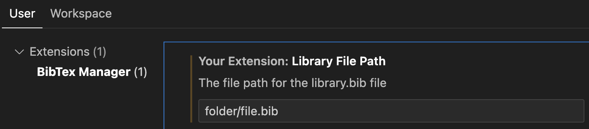
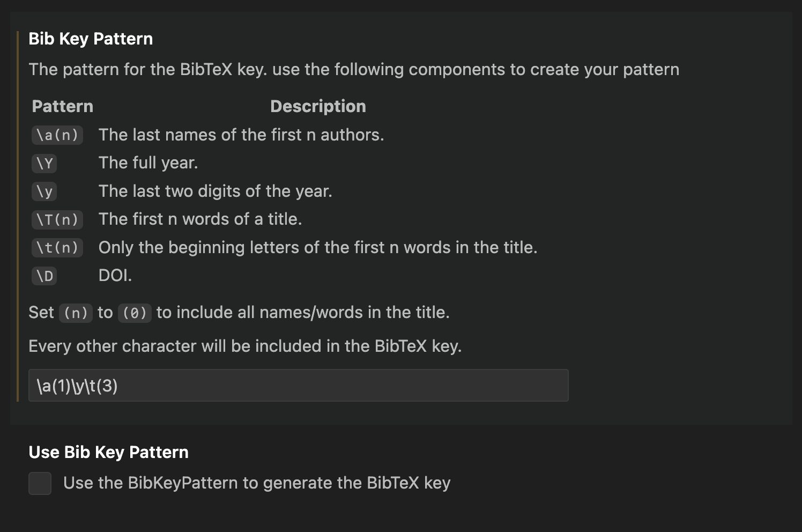

# BibTeX Manager
The BibTeX Manager is a helpful extension for Visual Studio Code that streamlines the process of fetching and managing BibTeX references for research papers and websites. It simplifies the retrieval of BibTeX entries, allowing you to effortlessly generate citations with just a few clicks.

## Features
### Fetching Paper-BibTeX
With release 1.0 we improved the usability by adding a visual interface for the BibTeX manager. 

1. Copy the title of any research paper to your clipboard.
2. Click "Add Citation" in the status bar, or click the "BibTeX Manager" icon in the activity bar and paste your title manually.
3. Pick the matching paper from the results.

The status-bar "Add Citation" action opens the BibTeX Manager view automatically if it isn't open yet.
<!--  -->
<!-- <video src="res/addCitation.mp4" autoplay loop muted playsinline title="Add BibTeX"></video> -->
 <!-- by https://www.xconvert.com -->

### Generating BibTeX for websites
Version 1.0 does not support generating BibTeX for websites yet. We removed the feature from the pre-release since it was incomplete.

### Customizable File Path
By default, the fetched BibTeX entries are saved to a file named `library.bib`. Set `bibtexManager.libraryFilePath` to override the location and filename. The path is workspace-relative; absolute paths are also accepted. The `.bib` extension is appended if you leave it off.

*Use workspace settings if you maintain several projects with different libraries.*

### Customizable BibTeX key
Set `bibtexManager.bibKey.usePattern` to `true` and choose a pattern via `bibtexManager.bibKey.pattern` to control how citation keys are generated. Otherwise the upstream key from Semantic Scholar is used.

### Semantic Scholar API key (recommended)
Searches go through the Semantic Scholar Graph API. Without a key, requests share a single global rate-limit pool with every other unauthenticated caller, which is frequently saturated and returns `429 Too Many Requests`. The extension already retries with backoff, but heavy usage will still fail intermittently.

To avoid this, request a free personal API key from Semantic Scholar and paste it into the extension settings:

1. Apply at [semanticscholar.org/product/api#api-key](https://www.semanticscholar.org/product/api#api-key). The key is emailed to you after approval (turnaround is at Semantic Scholar's discretion — usually days).
2. In VS Code, open Settings and search for `bibtexManager.semanticScholar.apiKey`.
3. Paste the key. It will be sent as the `x-api-key` header on every request.

The key is stored in your VS Code settings on your machine only — keep it private and do not share it.

## Development

- `npm install`
- `npm run compile` — production bundles (extension + webview)
- `npm run watch` — webpack watch mode
- `npm run test:unit` — pure-module unit tests (mocha)
- `npm test` — full VS Code integration tests
- Press <kbd>F5</kbd> in VS Code to launch an Extension Development Host.

## Release Notes
### 0.0.1

Initial release of the BibTeX Fetcher extension. 

### 0.0.2 

Minor fixes

### 0.1.0

Added automatic BibTeX generation for websites.

### 0.2.0 

Added the (long needed) option to use a custom filename.

### 0.3.0 

There was an issue with DBLP. Thats why i changed it so you now can choose the engine which is used to look up the citation in the settings. 

### 1.0.0
In this first mayor update we changed the following:
1. Introduced a visual interface when looking up and adding BibTeX.
2. Added the option to choose the required citation out of a list of papers. 
3. Added [SemanticScholar](https://www.semanticscholar.org) as the backend.
4. Bug fixes and rework of codebase.
5. Added new icon designed by [Ngoc-Han Le](https://www.linkedin.com/in/ngoc-han-le/).

This release should greatly improve the reliability of the BibTeX manager Extension.

### 1.1.0
Added the option to specify the BibTex key using a pallette of patterns. 

Added a warning if the BibTeX is invalid or incomplete. 

If you like the work done here, please give it a star on GitHub or in the extension store ⭐

Happy writing!

